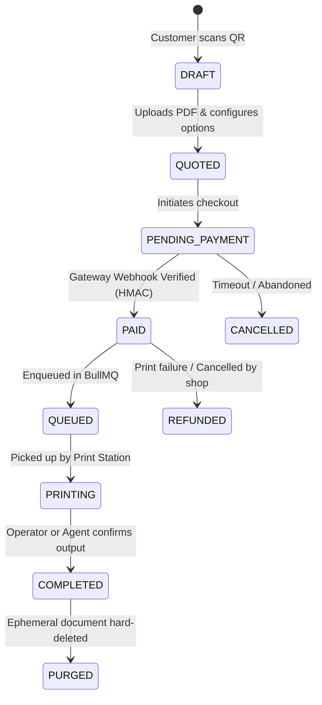

# QR-PrintHub Architecture Specification

## 1. System Topology Overview

QR-PrintHub is architected as a **Modular Monolith** designed for high cohesion, operational simplicity, and strict multi-tenant isolation.

```
                     +---------------------------------------+
                     |         Web Clients & Devices         |
                     |  - Customer Mobile Web (QR Scan Flow) |
                     |  - Merchant / Staff Web Dashboard     |
                     |  - Local Desktop Print Station Agent  |
                     +-------------------+-------------------+
                                         | HTTPS / WSS
                                         v
                     +---------------------------------------+
                     |        Fastify / Node API Core        |
                     |  (Reverse Proxy / Rate Limiter / Auth)|
                     +-------------------+-------------------+
                                         |
     +-------------------+---------------+-------------------+-------------------+
     |                   |               |                   |                   |
     v                   v               v                   v                   v
+----------+       +----------+    +----------+        +----------+        +----------+
|  Auth &  |       | Merchant |    | Document |        | Pricing  |        | Orders & |
|  Access  |       | & Shops  |    | Storage  |        |  Engine  |        | Payments |
+----+-----+       +----+-----+    +----+-----+        +----+-----+        +----+-----+
     |                  |               |                   |                   |
     +------------------+---------------+-------------------+-------------------+
                                         |
                                         v
                     +---------------------------------------+
                     |         Durable Async Queue           |
                     |          (BullMQ + Redis 7)           |
                     |  - Page Counter & PDF Sanitizer       |
                     |  - Auto-Purge Expiration Worker       |
                     |  - Print Job Dispatcher               |
                     +-------------------+-------------------+
                                         |
                        +----------------+----------------+
                        |                                 |
                        v                                 v
         +-----------------------------+   +-----------------------------+
         |     PostgreSQL 16 (DB)      |   |   MinIO / S3 Object Store   |
         |  Multi-tenant Relational DB |   |   Private Encrypted PDF     |
         +-----------------------------+   +-----------------------------+
```

---

## 2. Multi-Tenancy & Authorization Model

QR-PrintHub implements **Logical Row-Level Multi-Tenancy** within a shared database schema:

```
+--------------------------------------------------------------+
|                     Platform Super Admin                     |
|            (Platform-wide analytics, tenant billing)         |
+------------------------------+-------------------------------+
                               | 1:N
                               v
+--------------------------------------------------------------+
|                    Merchant Organization                     |
|           (Company entity, payout accounts, aggregate stats) |
+------------------------------+-------------------------------+
                               | 1:N
                               v
+--------------------------------------------------------------+
|                       Physical Shop                          |
|    (Dedicated QR Code, local printers, rates, staff users)   |
+------------------------------+-------------------------------+
                               | 1:N
                               v
+--------------------------------------------------------------+
|                    Orders, Jobs & Documents                  |
|          (Scoped strictly by shop_id and merchant_id)        |
+--------------------------------------------------------------+
```

### Tenant Isolation Rules
1. Every query executed on behalf of a shop user, staff member, or QR customer MUST include `where(eq(table.shopId, currentShopId))`.
2. Cross-tenant reads or updates are blocked by middleware (`TenantGuard`) and validated by automated isolation tests.
3. Database indices must include `(shop_id, ...)` on all hot lookup queries to guarantee high performance and query isolation.

---

## 3. Core Domain Modules

### 3.1. Document Management (`modules/documents`)
- **Direct-to-S3 Uploads**: Client requests an upload slot; backend validates MIME type and file size, generating a single-use presigned S3 PUT URL (TTL: 5 minutes).
- **Page Counting & Validation**: Once uploaded, an isolated background job inspects the PDF metadata using `pdf-lib` to determine actual page count, page dimensions (A4/A3), and color spectrum.
- **Tombstone & Hard Purge**: Uploaded customer documents are ephemeral. Files are scheduled for automated cryptographic deletion upon print completion or expiration (default: 2 hours).

### 3.2. Authoritative Pricing Engine (`modules/pricing`)
Pricing is **strictly deterministic and calculated on the backend**. Clients submit print options, but the server calculates and signs the price quote:

$$\text{Line Item Total} = \left(\text{Pages} \times \text{Rate}(\text{ColorMode}, \text{DuplexMode}, \text{PaperSize})\right) \times \text{Copies} + \text{FinishingFee}$$

- All currency amounts are stored and calculated in integer cents/paise.
- Floating-point calculations are strictly forbidden.

### 3.3. Order & Payment State Machine (`modules/orders`, `modules/payments`)



- **Idempotent Webhooks**: All payment webhooks are verified via HMAC-SHA256 signatures and recorded with unique gateway payment IDs to prevent replay attacks.

### 3.4. Print Queue & Dispatcher (`modules/queue`, `modules/print-stations`)
- **BullMQ Queue**: Each physical shop has a dedicated logical queue to prevent one shop's backlog from blocking another.
- **Shop Print Station Web UI**: Staff view pending jobs, verify customer order codes, and download jobs using single-use download tokens (TTL: 60 seconds).
- **Optional Local Hardware Agent**: A lightweight background daemon running on the print shop PC polling or subscribed via authenticated WebSocket/SSE, routing print jobs directly to local Windows Spooler or CUPS.

### 3.5. Audit Trail & Observability (`modules/audit`)
- Immutable log table storing actor, action, timestamp, IP address, tenant ID, and event metadata.
- Tracked actions: `DOCUMENT_UPLOADED`, `DOCUMENT_DOWNLOADED`, `PRICE_QUOTED`, `PAYMENT_RECEIVED`, `JOB_PRINTED`, `DOCUMENT_PURGED`.
